

<b>I design, ship and run production AI systems</b> — enterprise RAG assistants, Text-to-SQL, AI agents, 
document intelligence and computer vision — used daily by <b>900+ employees</b> across <b>20+ departments</b>.

## 📈 Impact at a Glance

---

## ⚡ About Me


I build AI systems that people use every day: retrieval-augmented assistants, Text-to-SQL, agents, document intelligence and computer vision. I also present and explain them to top management, business and technical consultants, and external partners.

---

## 💥 What I've Shipped in Production

<b>AI Engineer @ Akhnaton Trading & Distribution (EVA Group)</b> · May 2025 – Present

 

 
 

<b>➕ 5 more production systems</b>

 

 
 

---

## 🧭 How I Build

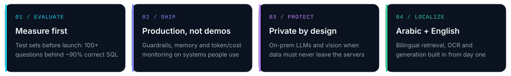

---

## 🛠️ Tech Stack

  

<b>🔎 Full toolbox</b>

 

| Area | Tools |
|---|---|
| 🧠 **LLMs & GenAI** | OpenAI, Anthropic Claude, OCI Generative AI, LangChain, LangGraph, Ollama (Aya-Expanse), Whisper, Deepgram |
| ⚙️ **LLM Engineering** | RAG pipelines, rerankers + BM25 hybrid retrieval, fine-tuning (LoRA / PEFT), prompt engineering, guardrails, token / cost monitoring |
| 🤖 **ML & Vision** | PyTorch, TensorFlow / Keras, scikit-learn, LightGBM, YOLO, OpenCV, Hugging Face |
| 🛠️ **Backend** | Python, FastAPI, Pydantic, REST APIs, Docker, GitHub Actions, Linux, Streamlit, HTML / CSS / JS / Bootstrap |
| ☁️ **Cloud & Data** | Microsoft Azure (AI Foundry, hands-on), Oracle Cloud & Autonomous DB, Google Cloud Vision, PostgreSQL / pgvector, ChromaDB, DuckDB, MySQL, MongoDB, Power BI |
| 🧑‍💻 **AI Coding** | Claude Code, Codex |

---

## 🚀 Featured Projects

Personal and open-source work. My production systems at EVA Group are private and listed above.

<a href="https://github.com/Geo-y20/Enhanced-Learning-Experience">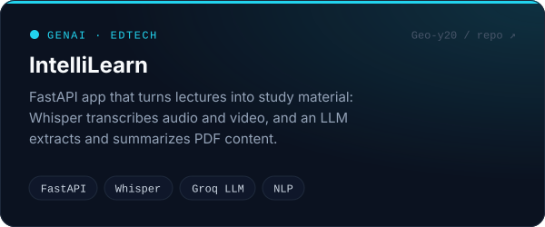</a>
<a href="https://github.com/Geo-y20/Vision-Project">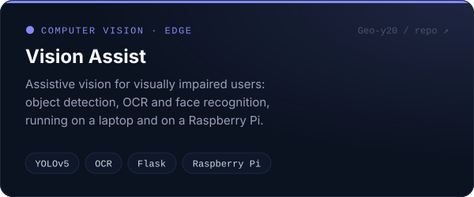</a>
 
<a href="https://github.com/Geo-y20/Text-Summarization-in-Arabic">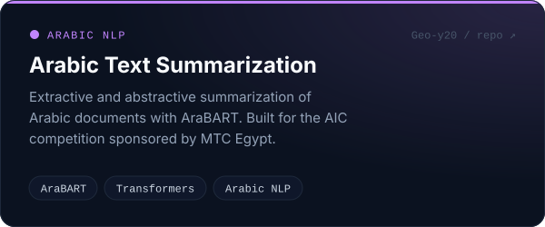</a>
<a href="https://github.com/Geo-y20/AI-Farmer-Assistant">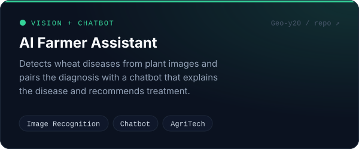</a>
 
<a href="https://github.com/Geo-y20/Fashion-Recommendation-System">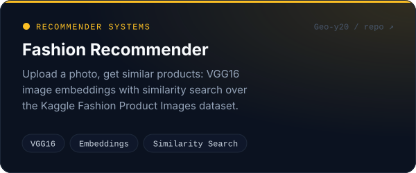</a>
<a href="https://github.com/Geo-y20/yolov8-holding-detector">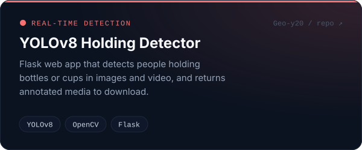</a>

<b>📂 More projects: data science, ML &amp; analytics</b>

| Project | What it does | Stack |
|---|---|---|
| [Telco Customer Churn](https://github.com/Geo-y20/Telco-Customer-Churn-) ⭐ 16 | Predicts telecom churn and recommends ways to reduce attrition | ML, EDA |
| [Uber Rides Analysis](https://github.com/Geo-y20/Uber-Rides-Data-Analysis) ⭐ 12 | Ride patterns by category, purpose, month, day and hour | pandas, visualization |
| [Standard OCR](https://github.com/Geo-y20/Standard-OCR-) | Character recognition comparing ResNet, Xception, Inception and MobileNet | Deep learning, CV |
| [Paper Title Generation](https://github.com/Geo-y20/Research-Paper-Title-Generation-using-bart) | Generates research-paper titles from abstracts | BART, Transformers |
| [Airline Reviews Prediction](https://github.com/Geo-y20/Airlines-Reviews-Prediction-Project) | Predicts review ratings from customer feedback text | NLP |
| [Fraud Detection](https://github.com/Geo-y20/Fraud-Detection) | Flags fraudulent credit-card transactions | ML classification |
| [Object Detection + TTS](https://github.com/Geo-y20/Object-detection-and-text-to-speech) | YOLOv5 detection with SpeechT5 text-to-speech | YOLOv5, SpeechT5 |
| [Arabic Sign Language](https://github.com/Geo-y20/Arabic_Sign_language) | Arabic sign-language recognition to help deaf and hearing people communicate | Computer vision |
| [RoboCup Junior](https://github.com/Geo-y20/RoboCup-Junior) | Line-follower robot for the RoboCup Junior competition | Robotics |

---

## 🛤️ Career Journey


<table width="100%">
<tr>
<td width="50%" valign="top">

### 📚 Teaching & Mentoring
- **AI & Data Science Instructor** at DEPI, Elharefa and iSchool
- 8-week cohorts of up to 25 students; **50+ learners** at Elharefa
- Mentoring 2 junior engineers and AI interns at EVA Group

</td>
<td width="50%" valign="top">

### 🏆 Recognition
- 🥇 **Intel ISEF**, 1st place
- 🥈 **NASA Space Apps Challenge**, 2nd place (Assiut)
- 🤖 **RoboCup Junior** participant
- 💻 **ECPC** (C++ competitive programming)
- ⭐ **100% Job Success** on Upwork (10+ projects)

</td>
</tr>
</table>

---

## 📜 Certifications

 

---

## 📊 GitHub Analytics

 

---

## 🎧 Now Playing

  

---

## 🌐 Let's Connect

  

