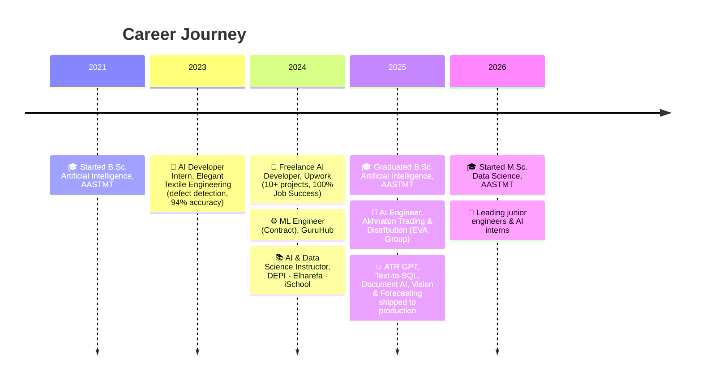

<div align="center">




<p>
<b>I design, ship and run production AI systems</b> — enterprise RAG assistants, Text-to-SQL, AI agents,<br/>
document intelligence and computer vision — used daily by <b>900+ employees</b> across <b>20+ departments</b>.
</p>

<a href="https://www.linkedin.com/in/george-youhana-a5b756155/"></a>
<a href="https://my-portfolio-nine-chi-v2lvpxtgph.vercel.app/"></a>
<a href="mailto:georgeyouhana2@gmail.com"></a>


</div>

## 📈 Impact at a Glance


---

## ⚡ About Me

```yaml
name:        George Youhana Heazil
role:        AI Engineer @ Akhnaton Trading & Distribution (EVA Group)   # May 2025 – Present
team:        Leading 2 junior engineers and AI interns
location:    Cairo, Egypt
focus:       [LLM Systems, RAG, AI Agents, Document AI, Computer Vision, MLOps]
education:   B.Sc. Artificial Intelligence, AASTMT (2025) | M.Sc. Data Science, AASTMT (in progress)
languages:   [Arabic (native), English (C1, EF SET)]
exploring:   [Human-in-the-loop agents, Langfuse / LangSmith, MCP]
daily_tools: [Claude Code, Codex, VS Code]
open_to:     Applied AI / LLM Engineer opportunities
```

I present and explain the AI systems I build to top management, business and technical consultants, and external partners. I care about measurable impact, not demos.

---

## 💥 What I've Shipped in Production

<div align="center"><sub><b>AI Engineer @ Akhnaton Trading & Distribution (EVA Group)</b> · May 2025 – Present</sub></div>
<br/>

<table width="100%">
<tr><td width="4%">🗣️</td><td width="26%"><b>ATR GPT</b><br/><sub>Enterprise AI Assistant</sub></td><td>FastAPI RAG on PostgreSQL/pgvector with <b>reranking</b> and <b>conversation memory</b>, used by <b>900+ employees</b> across 20+ departments (<b>5,000+ queries/month</b>) in MS Teams and on the web. Routes between OpenAI &amp; Claude, generates PowerPoint/Word files with AI agents, with guardrails &amp; token/cost monitoring</td></tr>
<tr><td>🔍</td><td><b>Enterprise Data Querying</b><br/><sub>Text-to-SQL + Sheet Chat</sub></td><td>Natural language → Oracle Autonomous DB across <b>10+ tables</b> in <b>~10 s</b> instead of 1–2 day reports, <b>~90% correct SQL</b> on 100+ test questions; plus a LangGraph agent for spreadsheet Q&amp;A, charts &amp; data-quality checks</td></tr>
<tr><td>📄</td><td><b>OCR &amp; Doc Intelligence</b></td><td>Cheque validation before ERP ingestion &amp; bilingual product-label extraction (batch, expiry, quantity) via Google Cloud Vision: <b>~95% field accuracy</b> on <b>1,000+ documents/month</b></td></tr>
<tr><td>🔒</td><td><b>Offline HR Assistant</b><br/><sub>Fully on-prem</sub></td><td>Arabic–English assistant on Aya-Expanse 8B (Ollama) with hybrid <b>ChromaDB + BM25</b> retrieval; no data ever leaves company servers</td></tr>
<tr><td>📈</td><td><b>Demand Forecasting</b></td><td>Per-brand / customer / channel forecasts with Ridge &amp; LightGBM and per-SKU model selection by wMAPE: <b>~15% lower wMAPE</b></td></tr>
<tr><td>👁️</td><td><b>Security &amp; Vision Platform</b></td><td>On-prem fire/violence detection, ALPR, driver-ID scanning, attendance &amp; people counting on <b>20+ cameras across 3 sites</b></td></tr>
</table>

<details>
<summary><b>➕ More production systems</b></summary>
<br/>

<table width="100%">
<tr><td width="4%">☎️</td><td width="26%"><b>Call Quality Analytics</b></td><td>CRM recordings → Whisper → LLM sentiment scoring of customer &amp; pharmacist calls for QA: <b>1,500+ calls/month</b></td></tr>
<tr><td>🎙️</td><td><b>Meeting Intelligence</b></td><td>Cross-platform desktop app for real-time Zoom/Teams transcription with Deepgram and bilingual Arabic–English minutes generated with OpenAI</td></tr>
<tr><td>🛒</td><td><b>Smart Sales Assistant</b></td><td>Catalog-aware sales ordering chatbot with AI-generated product recommendations</td></tr>
<tr><td>📋</td><td><b>Regulatory Content Platform</b></td><td>GSO-compliant cosmetics content: AI drafts, self-reviews, and outputs bilingual Arabic–English copy</td></tr>
<tr><td>💬</td><td><b>Social Listening Platform</b></td><td>Arabic social-media comment classification into 7 categories (pricing, delivery issues and more) with an interactive dashboard</td></tr>
</table>

</details>

---

## 🛠️ Tech Stack

<div align="center">


<br/><br/>


</div>

<details>
<summary><b>🔎 Full toolbox</b></summary>
<br/>

| Area | Tools |
|---|---|
| 🧠 **LLMs & GenAI** | OpenAI, Anthropic Claude, OCI Generative AI, LangChain, LangGraph, Ollama (Aya-Expanse), Whisper, Deepgram |
| ⚙️ **LLM Engineering** | RAG pipelines, rerankers + BM25 hybrid retrieval, fine-tuning (LoRA / PEFT), prompt engineering, guardrails, token / cost monitoring |
| 🤖 **ML & Vision** | PyTorch, TensorFlow / Keras, scikit-learn, LightGBM, YOLO, OpenCV, Hugging Face |
| 🛠️ **Backend** | Python, FastAPI, Pydantic, REST APIs, Docker, GitHub Actions, Linux, Streamlit, HTML / CSS / JS / Bootstrap |
| ☁️ **Cloud & Data** | Microsoft Azure (AI Foundry, hands-on), Oracle Cloud & Autonomous DB, Google Cloud Vision, PostgreSQL / pgvector, ChromaDB, DuckDB, MySQL, MongoDB, Power BI |
| 🧑‍💻 **AI Coding** | Claude Code, Codex |

</details>

---

## 🚀 Highlighted Projects

<table width="100%">
<tr>
<td width="50%" valign="top">

### [🎓 AI-Powered Learning Automation](https://github.com/Geo-y20/Enhanced-Learning-Experience)
FastAPI platform that turns lectures and documents into study material: Whisper transcription, PDF extraction and NLP summarization. Processed **5,000+** multimedia files.
<br/><sub>`Python` `FastAPI` `Whisper` `NLP`</sub>

</td>
<td width="50%" valign="top">

### [👁️ Vision Project](https://github.com/Geo-y20/Vision-Project)
Real-time computer vision system for object and event detection on live video streams.
<br/><sub>`Python` `YOLO` `OpenCV`</sub>

</td>
</tr>
<tr>
<td width="50%" valign="top">

### [📝 Arabic Text Summarization](https://github.com/Geo-y20/Text-Summarization-in-Arabic)
Summarization pipeline built for Arabic, handling the language's morphology and right-to-left text.
<br/><sub>`Python` `NLP` `Arabic NLP`</sub>

</td>
<td width="50%" valign="top">

### [🤟 Arabic Sign Language Recognition](https://github.com/Geo-y20/Arabic_Sign_language)
Real-time recognition of Arabic sign language gestures from a camera feed.
<br/><sub>`Python` `TensorFlow` `Computer Vision`</sub>

</td>
</tr>
</table>

<div align="center">
<a href="https://github.com/Geo-y20?tab=repositories">
  
</a>
</div>

---

## 🛤️ Career Journey



<table width="100%">
<tr>
<td width="50%" valign="top">

### 📚 Teaching & Mentoring
- **AI & Data Science Instructor** at DEPI, Elharefa and iSchool
- 8-week cohorts of up to 25 students; **50+ learners** at Elharefa
- Mentoring 2 junior engineers and AI interns at EVA Group

</td>
<td width="50%" valign="top">

### 🏆 Recognition
- 🥇 **Intel ISEF**, 1st place
- 🥈 **NASA Space Apps Challenge**, 2nd place (Assiut)
- 🤖 **RoboCup Junior** participant
- 💻 **ECPC** (C++ competitive programming)
- ⭐ **100% Job Success** on Upwork (10+ projects)

</td>
</tr>
</table>

---

## 📜 Certifications

<div align="center">


<br/>


</div>

---

## 📊 GitHub Analytics

<div align="center">


<br/>


</div>

---

## 🎧 Now Playing

<p align="center">
  <a href="https://github.com/kittinan/spotify-github-profile">
    
  </a>
</p>

---

## 🌐 Let's Connect

<div align="center">
<a href="https://www.linkedin.com/in/george-youhana-a5b756155/"></a>
<a href="https://my-portfolio-nine-chi-v2lvpxtgph.vercel.app/"></a>
<a href="mailto:georgeyouhana2@gmail.com"></a>
<a href="https://www.kaggle.com/georgeyouhanaheazil"></a>
<a href="https://twitter.com/georgeyouhana2"></a>

<br/><br/>


</div>
