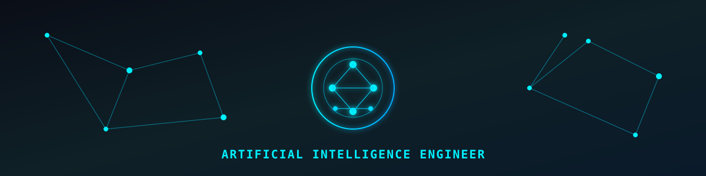
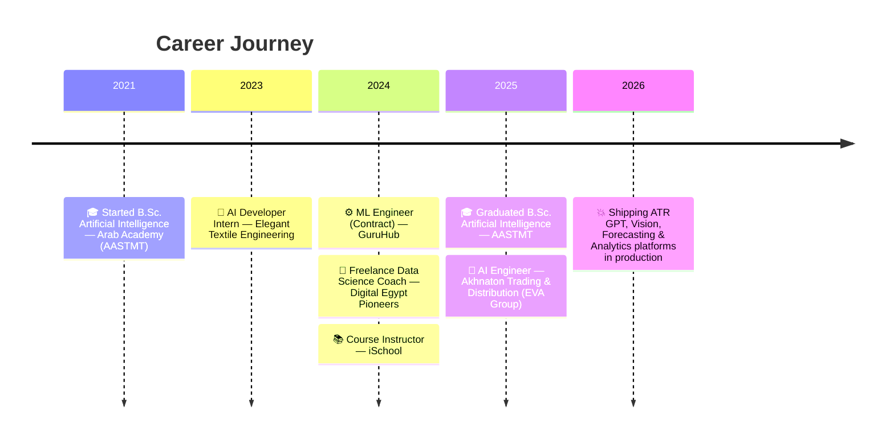

<div align="center">


<br/><br/>


<a href="https://www.linkedin.com/in/george-youhana-a5b756155/"></a>
<a href="https://my-portfolio-nine-chi-v2lvpxtgph.vercel.app/"></a>
<a href="mailto:georgeyouhana2@gmail.com"></a>

<br/>



</div>

<br/>

## ⚡ About Me

```yaml
👤 name:      George Youhana Heazil
💼 role:      Applied AI Engineer @ Akhnaton Trading & Distribution — EVA Group
📍 location:  Cairo, Egypt
🔭 focus:     [LLM Systems, RAG, AI Agents, Computer Vision, MLOps]
🎓 education: B.Sc. Artificial Intelligence — Arab Academy (AASTMT), 2025
🚀 mission:   Shipping production-grade AI systems with measurable impact
🌱 open_to:   Exciting AI/ML opportunities
```

<div align="center">

</div>

<br clear="right"/>

---

## 🎧 Now Playing

<div align="center">
<a href="https://github.com/kittinan/spotify-github-profile">
  
</a>
</div>

---

## 💥 What I've Shipped in Production

<div align="center"><sub><b>AI Engineer @ EVA Group</b> · May 2025 – Present</sub></div>
<br/>

<table width="100%">
<tr><td width="4%">🗣️</td><td width="26%"><b>ATR GPT</b><br/><sub>Enterprise AI Assistant</sub></td><td>FastAPI + PostgreSQL/pgvector RAG system serving <b>900+ employees</b> across 20+ departments; assistant mode routes across OpenAI &amp; Claude, generates PPT/Word via AI agents, with guardrails &amp; token/cost monitoring</td></tr>
<tr><td>🔍</td><td><b>Enterprise Data Querying</b><br/><sub>Text-to-SQL + Sheet Chat</sub></td><td>Natural language → Oracle Autonomous DB across <b>10+ tables</b> (~10s latency), plus a LangGraph agentic pipeline for spreadsheet Q&amp;A, visualization &amp; data-quality checks</td></tr>
<tr><td>📄</td><td><b>OCR &amp; Doc Intelligence</b></td><td>Automated cheque validation before ERP ingestion &amp; bilingual product-label extraction via Google Cloud Vision</td></tr>
<tr><td>📈</td><td><b>Demand Forecasting</b></td><td>Per-brand / per-customer / per-channel forecasts using Ridge &amp; LightGBM, with per-SKU model selection by wMAPE</td></tr>
<tr><td>☎️</td><td><b>Call Quality Analytics</b></td><td>CRM call recordings → Whisper transcription → OpenAI sentiment analysis, evaluating customer &amp; pharmacist interactions for QA</td></tr>
<tr><td>🛒</td><td><b>Smart Sales Assistant</b></td><td>Chatbot ordering assistant with full EVA pharma/cosmetics product knowledge &amp; AI-generated recommendations</td></tr>
<tr><td>📋</td><td><b>Regulatory Content Platform</b></td><td>GSO-compliance content system for cosmetics products — AI drafts, self-reviews, and outputs bilingual Arabic-English content</td></tr>
<tr><td>💬</td><td><b>Social Listening Platform</b></td><td>Facebook &amp; Instagram comment sentiment analysis (pricing, delivery issues) with an interactive dashboard</td></tr>
<tr><td>👁️</td><td><b>Security &amp; Vision Platform</b></td><td>On-prem fire/violence detection, ALPR, driver-ID scanning, attendance &amp; people counting across CPU/GPU</td></tr>
</table>

---

## 🛤️ Career Timeline



<div align="center"><sub>Rendered natively by GitHub — <a href="https://mermaid.js.org">Mermaid</a> timeline diagram</sub></div>


---

## 🛠️ Tech Arsenal

<div align="center">

**🤖 AI & Machine Learning**
<br/>


**🧠 LLMs & Generative AI**
<br/>


**⚙️ LLM Engineering & Ops**
<br/>


**🛠️ Backend & Infrastructure**
<br/>


**☁️ Cloud & Data**
<br/>


</div>

---

## 🚀 Highlighted Projects

<table width="100%">
<tr>
<td width="50%" valign="top">

### [🎓 AI-Powered Learning Automation](https://github.com/Geo-y20/Enhanced-Learning-Experience)
FastAPI platform for automated transcription (Whisper), PDF extraction & summarization — processed **5,000+** multimedia files.
<br/><sub>`Python` `Whisper` `NLP` `FastAPI`</sub>

</td>
<td width="50%" valign="top">

### [👁️ Vision Project](https://github.com/Geo-y20/Vision-Project)
Real-time computer vision detection system for object & event recognition.
<br/><sub>`OpenCV` `YOLO`</sub>

</td>
</tr>
<tr>
<td width="50%" valign="top">

### [📝 Arabic Text Summarization](https://github.com/Geo-y20/Text-Summarization-in-Arabic)
NLP summarization pipeline built specifically for Arabic text.
<br/><sub>`Python` `NLP`</sub>

</td>
<td width="50%" valign="top">

### [🤟 Arabic Sign Language Recognition](https://github.com/Geo-y20/Arabic_Sign_language)
Real-time recognition system for Arabic sign language.
<br/><sub>`Computer Vision` `TensorFlow`</sub>

</td>
</tr>
</table>

<div align="center">
<a href="https://github.com/Geo-y20?tab=repositories">
  
</a>
</div>

---

## 📊 GitHub Analytics

<div align="center">


<br/>


<br/>


<br/>


<br/><sub>💡 If a card above shows "downtime" — public stats mirrors are rate-limited by GitHub and occasionally lag; they self-recover, no action needed.</sub>

</div>

---

## 🌐 Let's Connect

<div align="center">
<a href="https://www.linkedin.com/in/george-youhana-a5b756155/"></a>
<a href="https://twitter.com/georgeyouhana2"></a>
<a href="https://www.kaggle.com/georgeyouhanaheazil"></a>
<a href="https://www.facebook.com/goerg.youhana/"></a>
<a href="https://instagram.com/george_youhana_"></a>
<a href="https://my-portfolio-nine-chi-v2lvpxtgph.vercel.app/"></a>

<br/><br/>


</div>


</div>
